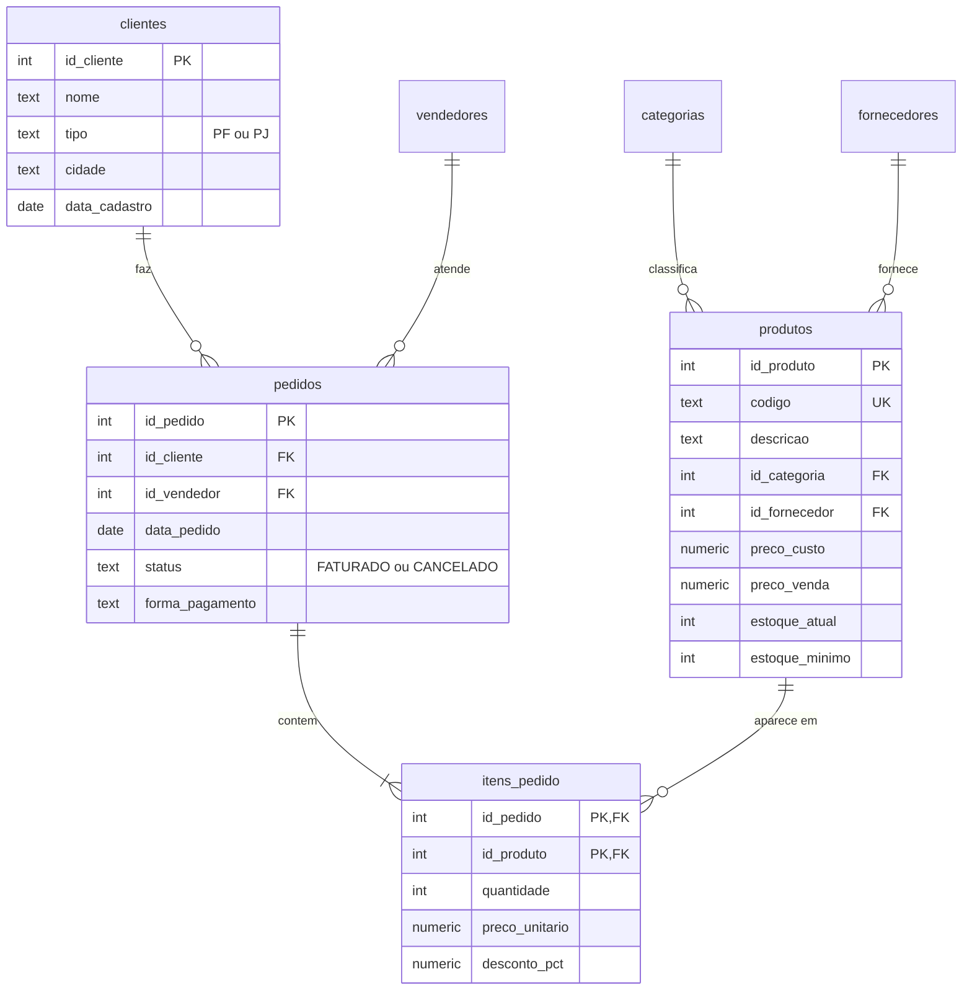

# Análise de vendas de uma distribuidora de autopeças (SQL)


Banco de dados de uma distribuidora de autopeças **fictícia**, com 22 meses de vendas, e **11 perguntas de negócio respondidas em SQL**: evolução do faturamento, curva ABC, margem por categoria, ranking de vendedores, clientes inativos, reposição de estoque e segmentação RFM.

Trabalho com um sistema ERP para o ramo de autopeças. Montei este projeto para praticar, fora do trabalho, o tipo de análise que esse negócio pede. **Todos os dados são inventados**, gerados por um script com semente fixa.

## A base em números

| Tabela | Linhas | | Indicador | Valor |
| --- | ---: | --- | --- | ---: |
| `pedidos` | 1.560 | | Faturamento (pedidos faturados) | R$ 1,06 milhão |
| `itens_pedido` | 4.023 | | Margem bruta média | 38,2% |
| `clientes` | 80 | | Crescimento jan–out 2026 vs. 2025 | +19,5% |
| `produtos` | 36 | | Participação das oficinas (PJ) | 82% |

## Modelo de dados



**Decisões de modelagem**

- `itens_pedido` guarda o **preço praticado na venda**, e não só o preço atual do produto. A tabela foi reajustada em 6% em janeiro de 2026, e o histórico de 2025 continua correto.
- Regras de negócio ficam no próprio banco, com `CHECK` (preço de venda ≥ custo, desconto entre 0 e 30%, status e forma de pagamento válidos), `UNIQUE` no código do produto e chaves estrangeiras.
- Há índices nas colunas usadas em filtros e junções (data do pedido, cliente, vendedor, produto).
- As views `vw_itens_vendidos` e `vw_pedidos_resumo` concentram as junções e os cálculos de valor. As consultas ficam mais curtas, e as views podem servir de fonte para um painel no Power BI.

## Estrutura

| Arquivo | Conteúdo |
| --- | --- |
| [`sql/01_schema.sql`](sql/01_schema.sql) | Criação das tabelas, restrições e índices |
| [`sql/02_dados.sql`](sql/02_dados.sql) | Carga dos dados fictícios |
| [`sql/03_views.sql`](sql/03_views.sql) | Views de itens vendidos e de resumo por pedido |
| [`sql/04_consultas.sql`](sql/04_consultas.sql) | As 11 perguntas de negócio |
| [`scripts/gerar_dados.py`](scripts/gerar_dados.py) | Script Python que gera o `02_dados.sql` |

A cada envio de código, o **GitHub Actions** executa os quatro scripts num banco novo e confere as chaves estrangeiras. Se algum SQL quebrar, o selo do topo fica vermelho.

## Como executar

**Sem instalar nada:** abra o [sqliteonline.com](https://sqliteonline.com/), cole o conteúdo de cada arquivo da pasta `sql/` na ordem (01 → 04) e clique em **Run**.

**No computador:** com o [DB Browser for SQLite](https://sqlitebrowser.org/), crie um banco novo e, na aba **Executar SQL**, rode os arquivos na ordem. Pelo terminal:

```bash
sqlite3 vendas.db < sql/01_schema.sql
sqlite3 vendas.db < sql/02_dados.sql
sqlite3 vendas.db < sql/03_views.sql
sqlite3 -header -column vendas.db < sql/04_consultas.sql
```

## Perguntas e o que a base mostra

| # | Pergunta | Técnicas |
| --- | --- | --- |
| 1 | Como o faturamento evoluiu mês a mês? | CTE, `LAG()` |
| 2 | De janeiro a outubro, 2026 vendeu mais que 2025? | agregação condicional com `CASE` |
| 3 | Quais os 10 produtos que mais faturam? | `SUM() OVER ()` |
| 4 | Curva ABC de produtos | soma acumulada com janela |
| 5 | Qual categoria dá mais margem? | agregação, margem % |
| 6 | Quem foi o melhor vendedor de cada trimestre? | `RANK() OVER (PARTITION BY)` |
| 7 | Quais clientes estão sem comprar há mais de 90 dias? | subconsulta, `julianday()`, `HAVING` |
| 8 | Oficinas (PJ) compram mais que pessoa física? | CTE, agregação em dois níveis |
| 9 | Quais produtos precisam de reposição urgente? | `LEFT JOIN` com subconsulta, `COALESCE` |
| 10 | Alguma forma de pagamento cancela mais? | taxa com agregação condicional |
| 11 | Segmentação RFM dos clientes | `NTILE()`, CTEs encadeadas |

Alguns resultados:

**Oficinas sustentam o negócio (pergunta 8).** São 30 dos 79 clientes que compraram, mas respondem por 82% do faturamento, com ticket médio quase 3 vezes maior.

| tipo | clientes | pedidos | faturamento | ticket médio | pedidos por cliente |
| --- | ---: | ---: | ---: | ---: | ---: |
| PF | 49 | 558 | R$ 190.681,17 | R$ 341,72 | 11,4 |
| PJ | 30 | 922 | R$ 867.565,01 | R$ 940,96 | 30,7 |

**Boleto cancela 3 vezes mais que Pix (pergunta 10).**

| forma de pagamento | pedidos | cancelados | taxa | valor cancelado |
| --- | ---: | ---: | ---: | ---: |
| BOLETO | 276 | 29 | 10,5% | R$ 33.329,10 |
| CARTAO | 516 | 24 | 4,7% | R$ 18.422,53 |
| DINHEIRO | 132 | 5 | 3,8% | R$ 1.978,45 |
| PIX | 636 | 22 | 3,5% | R$ 12.978,25 |

**O produto mais vendido está quase sem estoque (pergunta 9).** O óleo 5W30 é o item que mais fatura (pergunta 3), mas tem 5 unidades em estoque contra 221 vendidas nos últimos 90 dias. A consulta lista 10 produtos abaixo do mínimo, do mais vendido para o menos vendido.

| código | produto | estoque | mínimo | vendidas em 90 dias |
| --- | --- | ---: | ---: | ---: |
| AP-1026 | Óleo de motor 5W30 sintético 1 L | 5 | 40 | 221 |
| AP-1007 | Filtro de ar do motor | 2 | 32 | 139 |
| AP-1027 | Óleo de motor 15W40 mineral 1 L | 18 | 24 | 130 |

**13 clientes "em risco" já compraram R$ 273 mil (pergunta 11).** Eles compravam com frequência, mas estão em média há 92 dias sem pedir. É a lista que vale entregar à equipe de vendas.

| segmento | clientes | dias desde a última compra (média) | pedidos (média) | faturamento |
| --- | ---: | ---: | ---: | ---: |
| 1. Campeões | 21 | 9 | 32,0 | R$ 623.326,00 |
| 2. Novos ou ocasionais | 13 | 13 | 11,1 | R$ 46.435,76 |
| 3. Em risco (compravam muito) | 13 | 92 | 25,8 | R$ 273.389,55 |
| 4. Pouco engajados | 32 | 106 | 10,3 | R$ 115.094,87 |

## Limitações

- Os dados são sintéticos. Os padrões (sazonalidade, crescimento, cancelamentos) foram definidos no script para que as consultas tenham algo a mostrar.
- A margem usa o custo atual do produto, porque a base não guarda histórico de custo.
- Parte do crescimento de 2026 vem do reajuste de 6% na tabela de preços. Uma análise de volume deve comparar unidades vendidas, e não só valores.
- O SQLite foi escolhido para que qualquer pessoa rode o projeto sem instalar um servidor. As consultas usam SQL padrão (`JOIN`, CTE, funções de janela); só as funções de data (`strftime`, `julianday`, `date`) mudariam em PostgreSQL ou SQL Server.

---

Desenvolvido com apoio do Claude Code (IA). As perguntas de negócio partem da minha experiência com ERP de autopeças.
